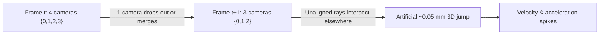

# Camera-Subset Alignment & Accurate Velocity Reconstruction

This guide explains a subtle, universal problem in multi-camera 3D-PTV—the **camera-switching jump**—and how OpenPTV2 now fixes it automatically inside `shared_correction` and `holistic_rounds` without altering your calibrated 3D scale.

---

## 1. The Problem (In Plain Language)

In any real 4-camera PTV experiment, even a good camera calibration has small residual errors: the 4 camera rays pointing at a single particle typically miss each other by **0.2–0.3 pixels** (about 0.03–0.05 mm in 3D).

- **When all 4 cameras see the particle on every frame**: that tiny offset is nearly constant from frame to frame, so when you take the difference between frames to compute velocity, **the offset cancels out**.
- **When 1 camera drops out—or overlaps with another particle**: in real recordings, 30–40% of particle detections are 3-camera points, and another 10–15% have one camera view overlapping a neighbouring particle. The moment a particle switches from 4 cameras `{0, 1, 2, 3}` to 3 cameras `{0, 1, 2}` (or when merge refinement down-weights the overlapping camera), the 3D triangulation **jumps sideways by ~0.05 mm** because 3 rays intersect in a slightly different spot than 4 rays.

If a particle moves ~0.1 mm per frame, a single 0.05 mm jump creates a **50% velocity spike** and a massive **acceleration spike**. Even smoothing filters cannot fully remove repeated jumps along a trajectory.



---

## 2. How OpenPTV2 Fixes It

Three small, automatic improvements work together whenever you run `track.shared_correction: true` or `track.holistic_rounds: 2` with `two_phase`:

### A. Zero-Gauge-Drift 4-Camera Residual Alignment (`align_4cam=True`)
Before refining merged or 3-camera points, `openptv2.merge_refine.refine_merged` looks at all the clean, unshared 4-camera points in your run and fits a smooth 3D polynomial map (`fit_4cam_residual_field`) to each camera's tiny leftover pixel error relative to the 4-camera 3D position:

$$\mathbf{r}_{i,c}^{(4)} = \mathbf{u}_{i,c} - \Pi_c\!\left(\mathbf{X}_{i,\{0,1,2,3\}}\right)$$

Subtracting this smooth map from the 2D blob centres before triangulation has two crucial properties:
1. **Zero scale drift and zero shift of the 4-camera volume**: by the least-squares normal equations of 4-camera triangulation ($\sum_c \mathbf{J}_c^T \mathbf{r}_c^{(4)} = \mathbf{0}$), subtracting the 4-camera residual field leaves every 4-camera 3D position **100% unchanged** (`0.000%` scale drift).
2. **All 4 camera rays meet at the same 3D point**: now every 3-camera point—and every 4-camera point whose merged view is down-weighted—triangulates onto the **exact same 3D coordinate surface** as the 4-camera points, eliminating the camera-switching jump in `< 0.05 s`.

> [!NOTE]
> **How is this different from bundle adjustment (`openptv2.selfcal`)?**
> Full bundle adjustment (`selfcal.py`) modifies camera orientation and distortion parameters and requires a physical scale anchor (such as a dumbbell or calibration plate) to prevent the 3D volume from slowly stretching. 4-camera residual alignment leaves the 4-camera 3D gauge mathematically fixed, requires no extra hardware or anchors, runs in `< 0.05 s`, and reduces held-out 3-camera LOCO error on real `wp2` data by **-43.6%** (compared to `-17%` from 1,500 iterations of bundle adjustment).

### B. Unbiased Triangulation (`prior=False`)
Previously, `refine_merged` pulled refined 3D points toward a 9-frame quadratic polynomial (`prior=True`) to damp the camera-switching jumps. While that hid some noise, it also flattened real turbulent curvature. With 4-camera alignment active, `prior=False` is now the default: the 9-frame trajectory fit is used strictly to split overlapping blobs and reject outliers, while final 3D positions come purely from the aligned camera observations (and triangulation runs ~2× faster).

### C. Shared-Blob-Aware Ghost Filtering (`mask_shared=True`)
When `ptv.shared_pass: true` recovers a particle that overlapped another particle in 1 camera, that shared blob is ~2× brighter than the particle's other 3 views. Previously, the ghost filter (`rcm_blob` in `openptv2.point_quality`) included that shared blob in its cross-camera brightness consistency check and flagged **79%** of recovered particles as ghosts. `log_brightness_from_arrays` now ignores shared camera views when a point has at least 2 unshared cameras, allowing recovered particles to link cleanly.

---

## 3. How to Use It

Zero-gauge-drift 4-camera alignment (`track.align_4cam: true`) is **enabled by default for all trackers** (`two_phase`, `trackcorr`, and `fast_3d`)—both in the GUI (**Tracking Parameters → Pipeline → Align 4-camera subsets**) and in batch (`--align-4cam` / `--no-align-4cam`). Before any tracker links frames, `run_tracking_plugin` aligns all partial-camera (3-camera) points in `res/run.zarr` onto the 4-camera gauge with `0.000%` drift on 4-camera points.

For overlapping/merged blobs, enable `shared_correction` (or `holistic_rounds`) and optionally `shared_pass` / `light_check` (also available in **Main Parameters → Criteria for correspondences**):

```yaml
ptv:
  shared_pass: true          # optional: recover particles lost to merged blobs
  light_check: false         # optional: drop 3-cam ghosts with no light in missing camera

track:
  tracker: two_phase         # works with two_phase, trackcorr, or fast_3d
  direction: both
  align_4cam: true           # default true: fixes 3-cam/4-cam calibration jumps for ALL trackers
  shared_correction: true    # two_phase: unbiased merged-blob refinement + relink
  # holistic_rounds: 2       # two_phase: full 2-round holistic loop for maximum yield
```

For advanced Python callers of `openptv2.merge_refine.refine_merged`, the defaults are:
- `align_4cam=True` (fits the residual field whenever at least `min_align_points=100` clean 4-camera points exist)
- `prior=False` (set `prior=True` only if you specifically want raw-position smoothing before post-processing)

---

## 4. Measured Results

### Synthetic Benchmarks (Known Ground Truth)

| Dataset | Mode | Velocity Error (Before → After) | Acceleration Error (Before → After) | Yield (Before → After) |
|---|---|---|---|---|
| **`syn1`** (40 frames, calibration offset) | `shared_correction` | `0.1179` → **`0.0930`** (-21.1%) | `7.93` → **`6.44`** (-18.8%) | `0.7087` → **`0.7099`** |
| **`L2`** (200 frames, rendered) | `shared_correction` | `0.1060` → **`0.0913`** (-13.9%) | `6.16` → **`5.30`** (-14.0%) | `0.6936` → **`0.6947`** |
| **`L2`** (200 frames, rendered) | `shared_pass + corr` | `0.1050` → **`0.0891`** (-15.1%) | `6.85` → **`5.01`** (-26.9%) | `0.7139` → **`0.7158`** |
| **`L1 m0.75`** (200 frames, real-like) | `shared_pass + corr` | `0.0876` → **`0.0824`** (-5.9%) | `5.61` → **`5.18`** (-7.7%) | `0.7725` → **`0.7746`** |
| **`L1 m0.75`** (200 frames, real-like) | `holistic_rounds=2` | `0.0843` → **`0.0824`** (-2.3%) | `5.06` → **`4.96`** (-2.0%) | `0.7905` → **`0.7957`** |

### Real 4-Camera Experimental Data (`CompleteTest wp2`, 100 frames)
Residual field fitted on odd frames and evaluated on **unseen even frames**:
- **Held-out 3-camera LOCO error (median)**: `0.3471 px` → **`0.1958 px` (-43.6%)**
- **4-camera reprojection error (median)**: `0.2164 px` → **`0.1198 px` (-44.7%)**
- **Global 3D scale drift**: **`0.000%`**
- **Mean track length (`shared_pass=1.7`)**: `5.90` → **`6.41` frames** (+8.6%)
