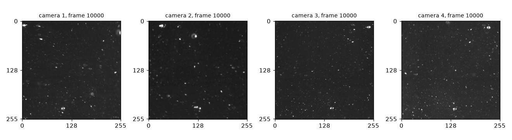
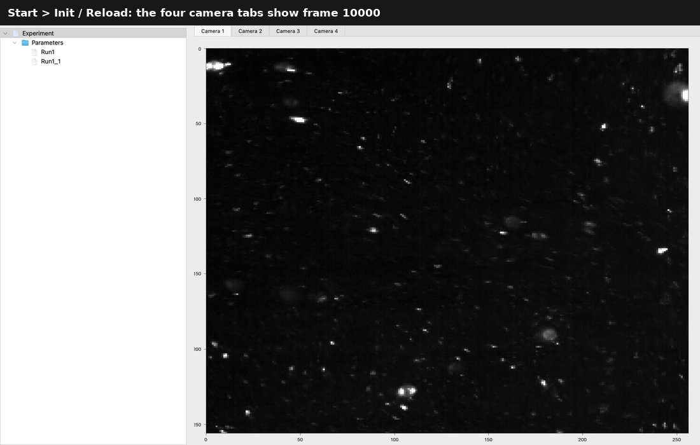

# 2. Your data: images, folders and the parameter file

**Time:** 10 minutes. **You need:** the repository folder from page 1.

## What this step does

Before you compute anything, you must know what the program expects: which files, in which folders, with which names, and
where the settings are. Most beginner problems are a file in the wrong place, or a setting that does not match the images.

## The example

`test_data/test_cavity_small` is a real experiment, cut down to 5 frames of 256 x 256 pixels:

```text
test_cavity_small/
├── parameters_Run1.yaml      all settings of this experiment, in one file
├── img/                      the images: one file per camera and frame
│   ├── cam1.10000  cam1.10001 ... cam1.10004
│   └── cam2.10000 ...  cam3.10000 ...  cam4.10000 ...
├── cal/                      the calibration: two small text files per camera
│   ├── cam1.tif.ori          where camera 1 is and where it looks (page 3)
│   ├── cam1.tif.addpar       its lens distortion
│   └── ... cameras 2, 3, 4
└── res/                      the results are written here
```

* **Image names** are `cam<camera number>.<frame number>`. The frame number is a counter. Here it runs from 10000 to 10004.
* **One frame** is one moment in time, seen by all four cameras: `cam1.10000`, `cam2.10000`, `cam3.10000`, `cam4.10000`.



*One moment, seen from four sides. The bright dots are tracer particles. The four pictures differ because each camera looks
from another side.*

## Work on a copy

The program writes its results into the folder. Do not write into the original. Make a copy and work in the copy for the whole
course:

```bash
cp -r test_data/test_cavity_small my_run
```

(On Windows, copy the folder in the file explorer and name it `my_run`.)

## The parameter file

`my_run/parameters_Run1.yaml` holds all settings. You rarely edit it by hand, because the window does it for you. But you must
be able to read it. These are the parts that matter first:

| Section | Key | Example | Meaning |
|---|---|---|---|
| (top) | `num_cams` | 4 | number of cameras |
| `ptv` | `imx`, `imy` | 256, 256 | image size in pixels |
| `ptv` | `pix_x`, `pix_y` | 0.012 | size of one sensor pixel in mm (12 micrometres) |
| `ptv` | `mmp_n1`, `mmp_n2`, `mmp_n3`, `mmp_d` | 1.0, 1.46, 1.33, 6.0 | refractive index of air, glass and water, and the glass thickness in mm (page 3) |
| `cal_ori` | `img_ori` | `cal/cam1.tif.ori` ... | which calibration file belongs to which camera |
| `sequence` | `first`, `last` | 10000, 10004 | the frames to process |
| `criteria` | `X_lay`, `Zmin_lay`, `Zmax_lay` | -10..10, -20..25 | the box in mm where you expect particles (the measurement volume) |
| `criteria` | `eps0` | 0.06 | how far (mm on the sensor) a spot may be from its epipolar line and still match (page 5) |
| `track` | `dvxmax` and similar | 15.5 | the largest step a particle may make between two frames, in mm (page 6) |

The image size, the pixel size and the volume are the settings that most often do not fit a user's own images.

## Do it

=== "Command line"

    Check that the program finds all files:

    ```bash
    python -c "
    from openptv2.recorrespond import load_parameters
    cpar, vpar, cals, params = load_parameters('my_run/parameters_Run1.yaml')
    print('cameras:', len(cals), ' image:', cpar.imx, 'x', cpar.imy, ' pixel:', cpar.pix_x, 'mm')
    "
    ```

=== "Graphical interface"

    ```bash
    openptv2-gui -w my_run/parameters_Run1.yaml
    ```

    Then choose **Start → Init / Reload** in the menu bar. The four camera tabs fill with the images of the first frame.

    

    *Left: the experiment tree (click Run1 for its parameters). Right: one tab per camera.*

## What you should see

The program prints one line *Loaded calibration for camera N from ...* for each camera, and then this line:

```text
cameras: 4  image: 256 x 256  pixel: 0.012 mm
```

## Check that it worked

The number of cameras and the image size must be the same as in your own images. If they are wrong, nothing later will be right.

## If it did not work

| You see | Cause | What to do |
|---|---|---|
| `FileNotFoundError` with a `.ori` name | the path in `cal_ori` is relative to the folder you started in | run from the repository folder, or use full paths |
| the camera tabs are empty | the image names do not follow `cam<N>.<frame>` | rename the images, or set `base_name` in the `sequence` section |
| `cameras:` shows a wrong number | `num_cams` and the number of `img_ori` entries differ | make them equal |

[Next: 3. Cameras and calibration →](03-cameras.md){ .md-button .md-button--primary }
