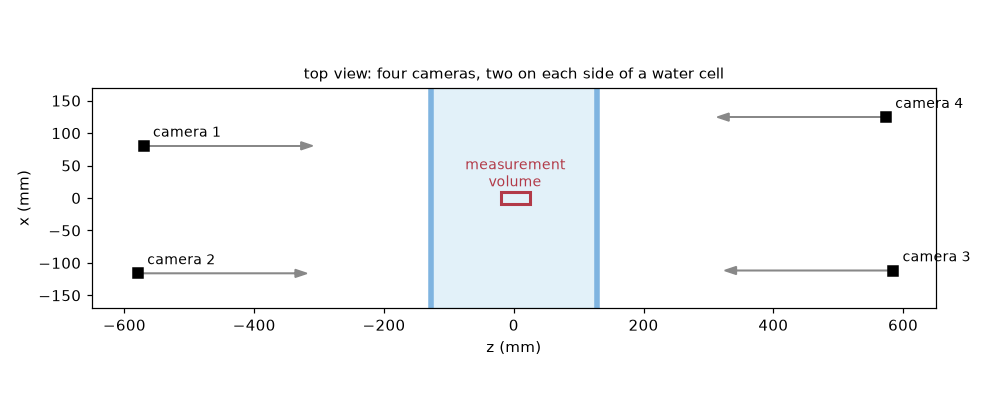

# 3. Cameras and calibration: how a spot in an image becomes a line in space

**Time:** 20 minutes. **You need:** the repository folder; pages 1 and 2.

## What this step does

An image gives you a spot at pixel (x, y). To turn that into a place in the lab you must know, for every camera: where it is,
which way it looks, how its lens maps directions to pixels, and how the window of the tank bends the light. That knowledge is the
**calibration**, two small text files per camera. Everything later (matching, 3D position, tracks) depends on it, so a
calibration that is a little wrong silently makes everything a little wrong.

## The idea in four lines

1. A camera is a **pinhole**: every spot is the image of a point somewhere along one straight line through the pinhole.
2. Where the pinhole is (x, y, z in mm) and which way the camera looks (three angles) are the **exterior** calibration.
3. The distance from the pinhole to the sensor (**cc**, here 70 mm), the **principal point** (where the axis meets the
   sensor) and the **lens distortion** (the lens bends straight lines slightly) are the **interior** calibration.
4. If the cameras look through a **window** into water, the light bends at the glass (Snell's law) and the line is no longer
   straight. The program corrects for it with the refractive indices and the glass thickness (`mmp_n1`, `mmp_n2`, `mmp_n3`,
   `mmp_d` in the YAML) and the window's position (the **glass vector**).

## Where the cameras are



*The example rig: two cameras on each side of a water cell with flat windows (blue). The red box is the measurement volume.
The origin of the laboratory coordinates is in the middle of the cell.*

## The files

Open `test_data/test_cavity_small/cal/cam1.tif.ori`:

```text
80.40705424 17.25785483 -570.09601905      position of the pinhole: x, y, z (mm)
    0.01531878  2.97855729  -0.01723759      the three angles (radians) of the look direction
    -0.9865926 -0.0170082  0.1623141       the same orientation as a 3 x 3 rotation matrix
    -0.0147487  0.9997770  0.0151150
    -0.1625349  0.0125185 -0.9866234
      0.0002  -0.0000                      principal point offset xh, yh (mm)
     70.0000                               cc: pinhole to sensor distance (mm)
       0.0  0.0  -125.0                    glass vector: where the window is (mm)
```

and `cam1.tif.addpar`, the lens terms `k1 k2 k3` (radial distortion), `p1 p2` (decentering), then a scale and a shear that are
`1` and `0` for a digital camera: `0 0 0 0 0 1 0` means "no distortion".

The **glass vector** is the arrow from the origin to the window, perpendicular to it. Here its length (125 mm) is the distance of
the window's water-side surface from the middle of the cell.

## Do it

=== "Command line"

    ```bash
    python -c "
    import numpy as np
    from openptv2.recorrespond import load_parameters
    from openptv2.loco import project_pixels

    cpar, vpar, cals, params = load_parameters('test_data/test_cavity_small/parameters_Run1.yaml')
    for i, c in enumerate(cals, 1):
        x, y, z = c.get_pos()
        print(f'camera {i}: position ({x:8.1f}, {y:7.1f}, {z:8.1f}) mm,  cc = {c.int_par.cc:.1f} mm,  glass vector {np.round(c.get_glass_vec(), 1)}')
    point = np.array([[0.0, 0.0, 0.0]])          # the middle of the measurement volume
    print('pixel of the point (0, 0, 0) in each camera:')
    for i, c in enumerate(cals, 1):
        u, v = project_pixels(point, c, cpar)[0]
        print(f'  camera {i}: x = {u:6.1f}, y = {v:6.1f}')
    "
    ```

=== "Graphical interface"

    The window shows the images, not the calibration numbers. To *see* the cameras in 3D, open the camera notebook, which reads
    the same `.ori` files from the YAML:

    ```bash
    marimo run src/openptv2/gui/visualize_cameras_nb.py
    ```

    (Calibrating, rather than reading, is **Calibration → Create calibration** in the window; see the
    [recipes](../recipes/index.md).)

## What you should see

```text
camera 1: position (    80.4,    17.3,   -570.1) mm,  cc =  70.0 mm,  glass vector [   0.    0. -125.]
camera 2: position (  -116.2,    29.5,   -578.9) mm,  cc =  70.0 mm,  glass vector [   0.    0. -125.]
camera 3: position (  -111.7,    70.6,    585.0) mm,  cc =  70.0 mm,  glass vector [   0.   0. 125.]
camera 4: position (   124.6,    67.0,    573.7) mm,  cc =  70.0 mm,  glass vector [   0.   0. 125.]
pixel of the point (0, 0, 0) in each camera:
  camera 1: x =   45.8, y =  226.5
  camera 2: x =   93.7, y =  224.7
  camera 3: x =  123.1, y =  246.6
  camera 4: x =  191.7, y =  165.2
```

## Check that it worked

Two quick sanity checks that catch most wrong calibrations:

1. **The point in the middle of the volume must land inside every image** (here 0 to 256 in both directions), not outside, not
   on an edge. If it does not, a camera file does not belong to this experiment or its units are wrong.
2. **The cameras on opposite sides must have glass vectors that point opposite ways** (here z = -125 and z = +125): each
   points from the middle of the cell to its own window.

A much stronger check, whether the cameras agree *with each other* on real particles, comes on [page 8](index.md#the-five-steps)
(*coming next*). A calibration can have a tiny reprojection error and still be wrong between cameras.

## See what the window does to a ray

The next notebook lets you move a particle and change glass thickness, water index and window tilt, and shows the bent light
ray. It is the quickest way to understand why the window matters:
[Ray tracing through the window](../ray-tracing-vs-radial-shift.md)
(`marimo edit docs/notebooks/ray_tracing_multimedia.py`).

## If it did not work

| You see | Cause | Do |
|---|---|---|
| the point lands outside the image | wrong camera file, wrong units (mm vs m), or a calibration of another setup | compare the position with the real rig by tape measure |
| all `k` terms are huge (more than 0.01) | a bad fit of the lens terms | set `.addpar` to zeros and recalibrate with more plate positions |
| the glass vector has length 0 | no window in this setup (cameras look directly into the fluid) | then `mmp_n2`, `mmp_n3`, `mmp_d` should be 1, 1, 0 |

[Next: coming next, find the particles](index.md){ .md-button }
