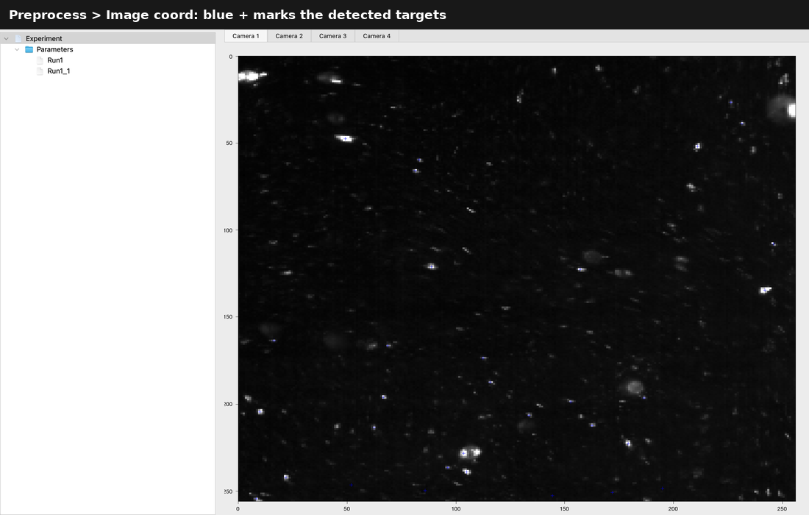
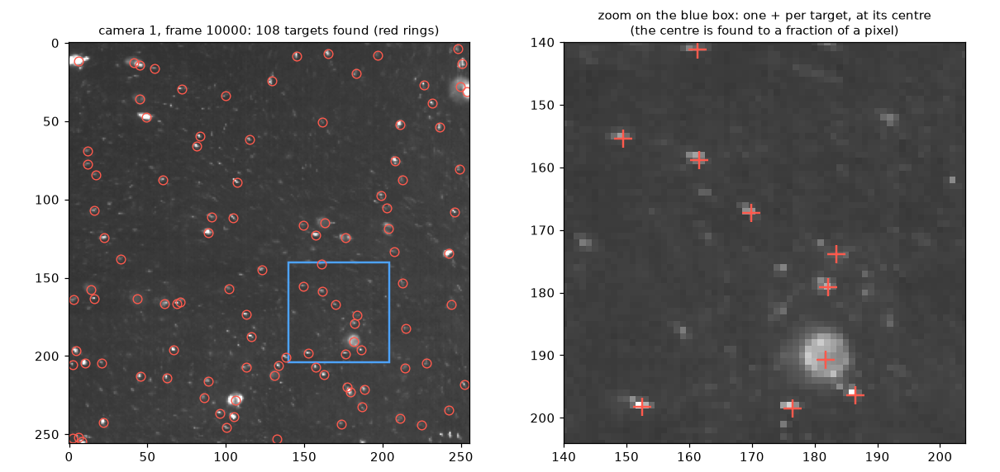
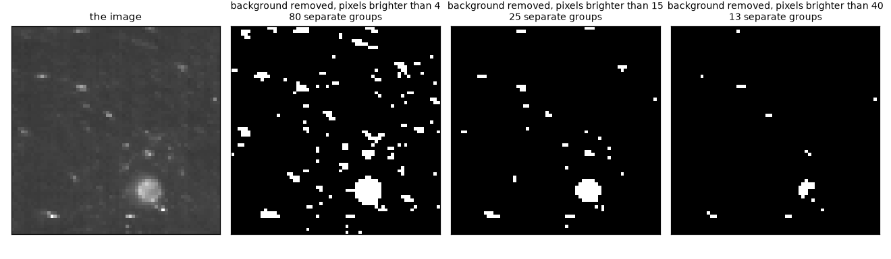

# 4. Find the particles in the images

**Time:** 15 minutes. **You need:** the `my_run` folder from page 2.

## What this step does

Detection finds the bright spots in each image and measures where their centres are. These spots are called **targets**.
A target is only a candidate: it can be a particle, a reflection, or noise. Later steps decide which are real.

The program does three things for every image:

1. It removes the slowly changing background (a *high-pass filter*), so that a bright wall does not look like a particle.
2. It marks every pixel brighter than a **threshold**.
3. It groups neighbouring marked pixels into one target. It keeps only the groups with a sensible size. The target centre is
   the brightness-weighted mean of its pixels, so it is known to a fraction of a pixel.

In the command line, detection and matching (page 5) run together, in one command. This page looks at the detection half.

## Do it

=== "Command line"

    Process the five frames. This detects the targets and matches them across cameras:

    ```bash
    openptv2-batch --workdir my_run --first 10000 --last 10004 --mode sequence
    ```

    Then count the targets that were found. The results are in `my_run/res/run.zarr`:

    ```bash
    python -c "
    from openptv2.storage.run_store import RunStore
    store = RunStore('my_run/res/run.zarr', mode='r')
    for frame in range(10000, 10005):
        print(frame, [len(store.read_targets(cam, frame)) for cam in range(4)])
    "
    ```

=== "Graphical interface"

    1. Open the example as on page 2 (**Start → Init / Reload**).
    2. Choose **Preprocess → Image coord**.

    Every camera tab now shows a small blue **+** on each detected target.

    

    *The marks are small. In the picture on this page, look for the blue + signs.*

## What you should see

The first command ends with `Batch processing completed successfully`. The second prints one line per frame: the frame number,
then the number of targets in cameras 1 to 4:

```text
10000 [108, 106, 117, 140]
10001 [116, 108, 114, 140]
10002 [122, 100, 122, 148]
10003 [129, 99, 118, 136]
10004 [117, 92, 109, 139]
```

This is what the first image looks like with the targets drawn on it:



*Left: 108 targets in camera 1. Right: the zoom on the blue box. Each + is the centre of one target.*

## Check that it worked

* **The numbers per camera should be similar from frame to frame.** Here they are all between 92 and 148. A camera that
  suddenly finds half as many targets has a problem: an image that is too dark, a lamp that flickered, a cable that moved.
* **Look at the picture, not only at the numbers.** Every bright dot should have a mark. Dim marks on empty background mean the
  threshold is too low.

## The threshold

The threshold decides what counts as bright. Here is the same small piece of image with three different thresholds:



*The picture is made with a simple background removal, to show the idea. The program uses its own high-pass filter.*

* **Too low (left):** noise becomes targets. Many false targets.
* **Too high (right):** faint particles are lost, and the real ones get too small.
* **Good (middle):** one group for each particle.

In the YAML the threshold is `gvthres` in the `targ_rec` section, one number per camera (here 4 grey levels on the filtered
image). The size limits are `nnmin` and `nnmax` (pixels in a target), `nxmin`, `nxmax`, `nymin`, `nymax` (width and height) and
`sumg_min` (minimum total brightness).

In the window, right-click `Run1` in the tree and choose **Main parameters**.

## If it did not work

| You see | Cause | What to do |
|---|---|---|
| very few targets | threshold too high, or `sumg_min` too high | lower `gvthres` a little and run again |
| many targets on empty background | threshold too low | raise `gvthres` |
| long streaks become one target, or one particle becomes two | the size limits do not fit your particles | change `nnmax` and the width and height limits |
| no targets at all in one camera | wrong image folder or name for that camera | check the `img_name` entries |

[Next: 5. Match across cameras →](05-match.md){ .md-button .md-button--primary }
