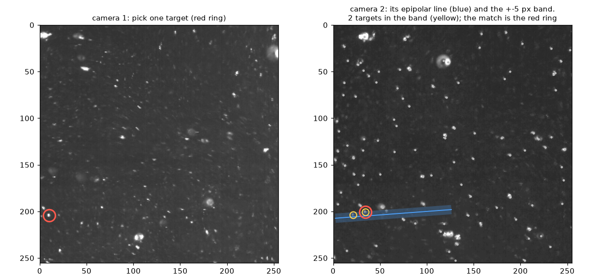
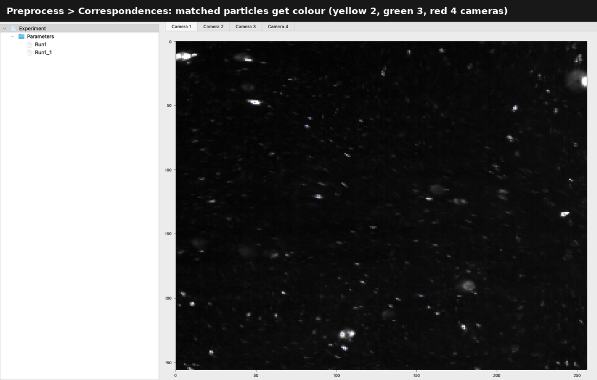
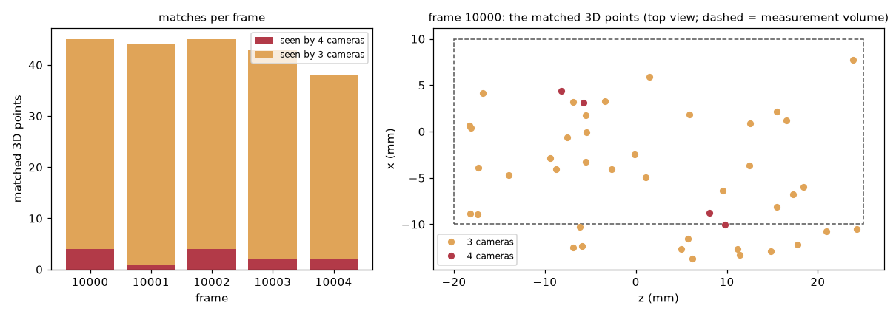

# 5. Match across cameras and get 3D points

**Time:** 15 minutes. **You need:** the results of page 4 (`my_run/res/run.zarr`).

## What this step does

Each camera has its own list of targets. Matching finds the targets in different cameras that are the same particle. Then it
computes the 3D position of each particle. Two ideas do the work.

**1. The line of sight.** A target in camera 1 is the picture of a particle that lies somewhere on one straight line in space.
Seen from camera 2, that line is a line in the image: the **epipolar line**. The same particle must be on this line in
camera 2.

**2. More cameras settle doubts.** Often two or three targets in camera 2 are near the line. Camera 3 and camera 4 each have
their own line. Only the true particle fits the lines of all cameras.

Then the **lines of sight cross** at the particle. The crossing is its 3D position. This is called *triangulation*.



*Left: one target of camera 1 (red ring). Right: its epipolar line in camera 2 (blue) and the band of +-5 px around it. Two
targets are in the band (yellow). The true match is the one with the red ring. Camera 3 and 4 decide which one it is.*

The band half-width is `eps0` in the YAML. Here `eps0` is 0.06 mm, which is 5 pixels of 12 micrometres. A small `eps0` loses
true matches when the calibration is not perfect. A large `eps0` lets in false ones.

A false match is called a **ghost**: targets of different particles that happen to line up. The more cameras agree, the fewer
ghosts. A point seen by 4 cameras is safer than one seen by 3.

## Do it

The matching ran together with detection on page 4. Count what it found:

=== "Command line"

    ```bash
    python -c "
    from openptv2.storage.run_store import RunStore
    store = RunStore('my_run/res/run.zarr', mode='r')
    for frame in range(10000, 10005):
        pos, cams = store.read_correspondences(frame)
        seen = (cams >= 0).sum(axis=1)
        print(frame, len(pos), 'points:', int((seen == 4).sum()), 'by 4 cameras,', int((seen == 3).sum()), 'by 3 cameras')
    "
    ```

=== "Graphical interface"

    Choose **Preprocess → Correspondences** (after **Image coord**). The marks of matched particles change colour: yellow
    for 2 cameras, green for 3, red for 4.

    

    *The coloured marks are small, as on page 4.*

    To process all frames at once, choose **Sequence → Sequence without display**.

## What you should see

```text
10000 45 points: 4 by 4 cameras, 41 by 3 cameras
10001 44 points: 1 by 4 cameras, 43 by 3 cameras
10002 45 points: 4 by 4 cameras, 41 by 3 cameras
10003 43 points: 2 by 4 cameras, 41 by 3 cameras
10004 38 points: 2 by 4 cameras, 36 by 3 cameras
```



*Left: matched points per frame. Right: the 3D points of frame 10000, seen from above. The dashed box is the measurement
volume of the YAML.*

## Check that it worked

* **Most targets should become 3D points.** In a good run, a large share of the targets of each camera is part of a match.
  Here there are about 100 targets per camera and 45 points. Most points are seen by three cameras and only a few by all four, and one
  camera sees them dimmer than another.
* **Many points should be seen by 4 cameras.** Here only about 3 of 45 are. This example is a small crop of a bigger image, so
  few particles are inside all four fields of view. A real run should have far more. If you have many 3-camera points and
  almost no 4-camera points, one camera probably has a poor calibration.
* **All points should lie inside the dashed volume.** Points outside it mean the volume in the YAML (`X_lay`, `Zmin_lay`,
  `Zmax_lay`) is too small or wrong.

## If it did not work

| You see | Cause | What to do |
|---|---|---|
| no matches at all | the calibration does not fit the images, or the volume is wrong | check page 3, then the volume in the YAML |
| few matches, many targets | `eps0` too small for your calibration | raise `eps0` step by step (for example 0.06 to 0.1) and watch the ghosts |
| many matches but they look random | `eps0` too large, or too many particles | lower `eps0`. Page 7 shows how to measure ghosts. |
| one camera never takes part | its calibration is wrong | open the images and compare the particle pattern with the other cameras |

[Next: 6. Track in time →](06-track.md){ .md-button .md-button--primary }
