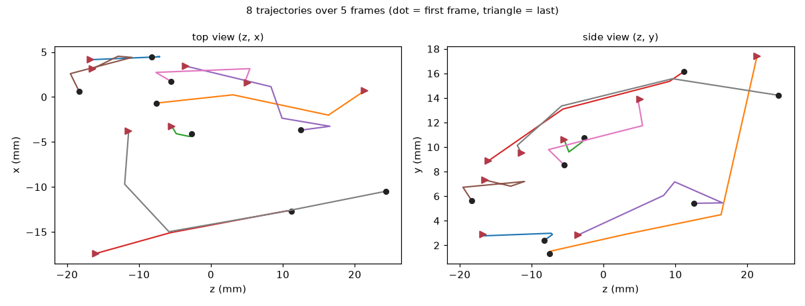

# 6. Track the particles in time

**Time:** 10 minutes. **You need:** the results of pages 4 and 5.

## What this step does

Matching gives a cloud of 3D points for each frame. It does not say which point in frame 2 is the same particle as a point in
frame 1. Tracking links them.

The idea is simple:

1. Take a particle in frame 1. **Predict** where it will be in frame 2 from its last step (a particle moves smoothly).
2. Look for 3D points near the prediction. Never look farther than the largest step you allow (`dvxmax`, `dvymax`, `dvzmax`
   in the YAML, here 15.5 mm per frame).
3. **Link** the particle to the best candidate. Repeat for every frame.

A chain of links is a **trajectory**. The speed is the step divided by the time between frames.

The default tracker is `two_phase`. It first links the clear cases and then the doubtful ones. The program tells you the name:
`TwoPhaseTracker`.

## Do it

=== "Command line"

    ```bash
    openptv2-batch --workdir my_run --first 10000 --last 10004 --mode tracking
    ```

    This reads the 3D points from page 5 and writes the trajectories to the same `run.zarr`.

=== "Graphical interface"

    Choose **Tracking → Tracking without display**. To see the result, choose **Tracking → Show trajectories**.

## What you should see

The output has one line per frame, a warning, and some summary lines. These are the lines to look at:

```text
Average over sequence, particles: 43.0, links: 20.8, lost: 22.2
Sealed: {'n_trajectories': 8, 'n_rows': 40, 'n_dropped': 0}
Batch processing completed successfully
```

* *particles 43.0*: on average 43 points per frame
* *links 20.8*: on average 20.8 of them were linked to a point of the next frame
* *8 trajectories*, 40 points in all: eight particles that were followed through all five frames
* *Sealed*: the trajectories were written to the run folder. Without this line nothing was saved.

The line that starts with `TwoPhaseTracker: v_max=15.5 mm/frame is large` is a warning, not an error. The parameter file of this
example allows a particle to move 15.5 mm between two frames, which is much more than it really moves here. A looser limit gives the
tracker more wrong candidates. The warning is about a second safety check (`confirm_tol`) that is off. For this course you can ignore
it; for your own data, set the speed limit near your real largest step (page 9 measures the steps), as described on the
[trackers page](../trackers.md).



*Top and side view of the trajectories. Each colour is one particle. The dot is its first position and the triangle its last
one. The paths are not smooth, and the next page explains why this matters.*

## Check that it worked

See the next page. A run that ends with "completed successfully" can still give wrong tracks. The tracker always finds
*something* to link.

## If it did not work

| You see | Cause | What to do |
|---|---|---|
| `0 links` | no points were saved (matching did not run) | run `--mode sequence` first |
| very few links | the allowed step is too small for your flow | raise `dvxmax`, `dvymax`, `dvzmax` |
| a message about `v_max is large` | the allowed step is very large compared with the particle spacing | see page 7: large steps allow many wrong links |

[Next: 7. Is the result good? →](07-check.md){ .md-button .md-button--primary }
