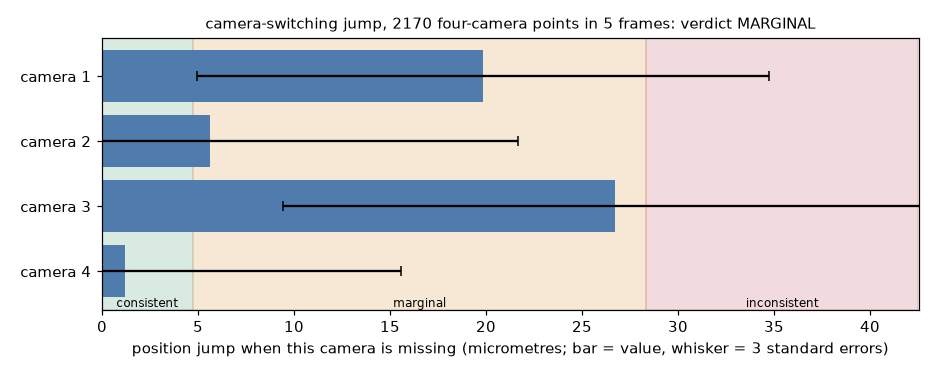

# 8. Is the calibration good?

**Time:** 15 minutes. **You need:** the `my_run` folder with the results of pages 4 to 6, and the repository folder.

## What this step does

Page 3 gave you two quick checks of the camera files. This page checks the calibration on the **real particles** of your run.
It is the check that finds the most common hidden problem: the cameras disagree a little with each other.

## Why the usual number is not enough

The usual number is the **reprojection error**: project a known point into one image and measure the miss in pixels. It looks
at one camera at a time. Four cameras can each have a small reprojection error and still disagree about where a particle is.

The disagreement shows up in a simple way. Take a particle seen by four cameras. Compute its position from all four cameras.
Then compute it again from three cameras (leave one out). If the cameras agree, the two positions are the same. If not, the
position **jumps** when the set of cameras changes. A track that is seen by 4 cameras in one frame and by 3 in the next
frame gets a false step of that size.



*Example from the larger run on this page. The bar is the jump when one camera is missing. The whisker is 3 standard errors: if
it does not touch 0, the jump is real and not noise. The colours show the verdict.*

## Do it

First, the small example. Run the check on the folder `my_run` (five frames, from page 6):

=== "Command line"

    ```bash
    python -m openptv2.calibration_consistency check my_run --first 10000 --last 10004
    ```

=== "Graphical interface"

    This check has no menu entry yet. Use the command line.

The small example has too few points to judge:

```text
calibration consistency: only 13 four-camera points on their own blobs (need 300): too few to judge
```

That is a correct answer. The check needs about 300 points seen by four cameras. A check that says "I cannot tell" is better
than one that always says "fine".

Now the larger example, `test_data/test_cavity`. It is the same experiment with full images. Copy it, process five frames
(this takes a few seconds), and check:

```bash
cp -r test_data/test_cavity big_run
```

```bash
openptv2-batch --workdir big_run --first 10000 --last 10004 --mode both
```

```bash
python -m openptv2.calibration_consistency check big_run --first 10000 --last 10004
```

## What you should see

```text
calibration consistency: MARGINAL  (2170 four-camera points in 5 frames, 1 px = 95 um; 12 % left out as wrong matches)
  camera   residual median/p90 (px)   smooth field (px)   field reproducible   jump when missing (um): systematic +- s.e. / rms
       1      0.753 / 1.879             0.300                4 %       19.9 +- 5.0 / 217.4
       2      0.733 / 1.758             0.254                0 %        5.6 +- 5.3 / 233.7
       3      0.618 / 1.639             0.234                0 %       26.7 +- 5.8 / 251.7
       4      0.651 / 1.619             0.158                0 %        1.2 +- 4.8 / 209.5
  worst systematic jump 0.28 px footprint -> small systematic offsets between camera subsets; align_partial_points() can remove them, or re-calibrate
```

The command returns exit code 0 when the verdict is *consistent*, or when it cannot judge ("too few points"), and 1 for *marginal* and *inconsistent*, so a script can use it as a gate.

## How to read it

* **First line:** the verdict, how many points it used, how big one pixel is in the volume (here 95 micrometres), and the share of
  points it left out because their cameras disagree wildly (wrong matches, called ghosts).
* **Residual median / p90:** how far the blob in each image is from the projection of the 4-camera 3D point, in pixels. Half of
  the points are closer than the first number, nine tenths are closer than the second.
* **Smooth field (px):** the part of the residual that changes slowly across the image, like a small warp. A random error does not
  do that, a calibration error does.
* **Field reproducible:** the share of that smooth field that is real. The program fits the field on the odd frames and tests it on
  the even frames. Near 0 % means the field is noise; a high share means a real, repeatable error. With five frames the number is small and uncertain.
* **Jump when missing:** the table's main column. The systematic part is the average jump. The `+-` is its standard error. The
  last number is the random scatter of single points (the noise of one point).
* **Last line:** the biggest systematic jump, measured in "pixel footprints" (one pixel size in the volume), and what to do.

| Verdict | Biggest systematic jump | What it means | What to do |
|---|---|---|---|
| **consistent** | below 0.05 px | the cameras agree | nothing |
| **marginal** | 0.05 to 0.30 px | small offsets between camera sets, below the noise of one point | fine for most work. If you need the last accuracy, repair (below). |
| **inconsistent** | above 0.30 px | the cameras clearly disagree | fix the calibration first. Do not trust tracks that change camera sets. |
| **inconclusive** | not measurable | too few points, or the numbers are noise | use more frames, then check again |

In the example the verdict is *marginal*: cameras 1 and 3 jump by 20 and 27 micrometres, which is 0.2 to 0.3 of a pixel, and
the whiskers show that this is real.

## What you can do about it

1. **Nothing, if the verdict is consistent or marginal and your tracks are long.** The jump is much smaller than the
   noise of one point (210 to 250 micrometres here).
2. **Calibrate again with the plate** (best, if you can). See the [recipes](../recipes/index.md).
3. **Self-calibration:** improve the cameras using the tracer particles themselves, with no plate. This works, but it can
   change the scale and shape of the volume a little, and no particle-only method can measure that change. Read
   [Calibration consistency check](../calibration-consistency.md) and
   [Self-calibration scale bias](../self-calibration-scale-bias.md) before you use it.

## If it did not work

| You see | Cause | What to do |
|---|---|---|
| "too few to judge" | fewer than 300 four-camera points | process more frames |
| `FileNotFoundError ... run.zarr` | the run was not processed in that folder | run pages 4 to 6 first, or the `openptv2-batch` line above |
| "only 3 cameras" or similar | the check needs 4 cameras | with 2 or 3 cameras, use the plate checks of page 3 |
| a verdict that changes between runs | too few points: the noise decides | use more frames until it stops changing |

[Next: 9. Use the results →](09-results.md){ .md-button .md-button--primary }
