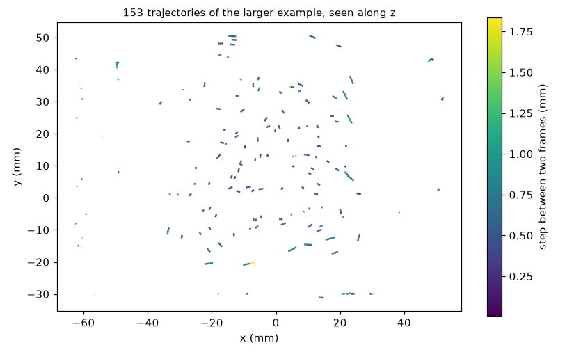

# 9. Use the results: read the trajectories and get velocities

**Time:** 15 minutes. **You need:** the `big_run` folder from page 8.

## What this step does

All results are in one place, `res/run.zarr`. This page shows how to read the trajectories, what the numbers mean, and how to get
a velocity from them. We use the larger example, because its tracks are good enough to look at.

## What is stored

| What | Where | Unit |
|---|---|---|
| targets (spots) of each camera and frame | `targets/` | pixels |
| 3D points of each frame, and which targets made them | `correspondences/` | **millimetres** |
| trajectories (after tracking) | `trajectories/` | positions in **metres** |

> **Careful with units.** The matched 3D points are in millimetres. The trajectories are in metres. The stored `vel` and `accel`
> arrays are empty (all zeros): the tracker stores positions, and you compute the velocity from them, as below.

To open the store from Python:

```python
from openptv2.storage.run_store import RunStore
store = RunStore("big_run/res/run.zarr", mode="r")
tr = store.trajectories()        # dict: pos (N, 3), time (N,), trajid (N,)
```

Each row is one point of one trajectory: its position, the frame number (`time`) and the trajectory number (`trajid`).

## From positions to velocity

A particle's velocity is how far it moves in one frame divided by the time of one frame. The raw difference of two positions is
noisy, because every position has an error. A better way is to fit a smooth curve through the track and take its slope. The
simplest curve is a quadratic in time (constant acceleration).



*152 trajectories of 5 frames each. The colour is the step between two frames.*

## Do it

```bash
python -c "
import numpy as np
from openptv2.storage.run_store import RunStore

store = RunStore('big_run/res/run.zarr', mode='r')
tr = store.trajectories()
speeds, noise = [], []
for i in np.unique(tr['trajid']):
    m = tr['trajid'] == i
    order = np.argsort(tr['time'][m])
    t = tr['time'][m][order].astype(float)
    p = 1000 * tr['pos'][m][order]                       # metres to mm
    if len(t) < 4:
        continue
    coef = np.polyfit(t - t.mean(), p, 2)                # one quadratic per coordinate
    fit = np.stack([np.polyval(coef[:, k], t - t.mean()) for k in range(3)], axis=1)
    noise.append(np.sqrt(np.mean(np.sum((p - fit) ** 2, axis=1))))
    speeds.append(np.linalg.norm(coef[1]))               # speed at the middle frame, mm per frame
print('trajectories with 4 or more frames:', len(speeds))
print(f'median speed {np.median(speeds):.2f} mm/frame')
print(f'median distance of the points from the fitted curve {np.median(noise):.2f} mm')
"
```

## What you should see

```text
trajectories with 4 or more frames: 152
median speed 0.33 mm/frame
median distance of the points from the fitted curve 0.06 mm
```

## Check that it worked

* **Speed in physical units:** multiply by your frame rate. For example 0.34 mm per frame at 100 frames per second is 34 mm per
  second. The example data come without a stated frame rate, so we leave it in "per frame".
* **Fit distance:** the median distance of the points from the curve is a rough measure of the position noise. A track that
  needs much more than the typical value is suspect. With 5 points and 3 fit numbers per coordinate, this value is **lower
  than the true noise**. Use longer tracks to measure noise properly.
* **Speed against noise:** here the step per frame (0.34 mm) is only a few times bigger than the noise. The velocity of one
  short track is therefore rough. Averages over many tracks are better than single tracks.

## Where to go from here

* **Longer runs:** process all your frames, not five. Tracks of 20 or more frames allow better fits.
* **Settings for your flow:** [Tracking parameters](../tracking_parameters_guide.md) and
  [Tracker engines](../tracker-tutorials.md).
* **Statistics of the flow** (Lagrangian and Eulerian): [Lagrangian turbulence quality](../lagrangian_turbulence_quality_guide.md).
* **Look at the tracks in 3D:** in the window, **Tracking → Visualize 3D trajectories**, or **Tracking → Save Paraview files**.
* **Your own experiment:** the [recipes](../recipes/index.md).

## If it did not work

| You see | Cause | What to do |
|---|---|---|
| `Sealed` is missing and there are no trajectories | tracking did not run | run `openptv2-batch ... --mode tracking` |
| speeds 1000 times too big or small | mixed up metres and millimetres | positions of trajectories are in metres (see the table) |
| `vel` is all zeros | the tracker does not store velocities | compute them as above |

[Back to the start](index.md){ .md-button }
