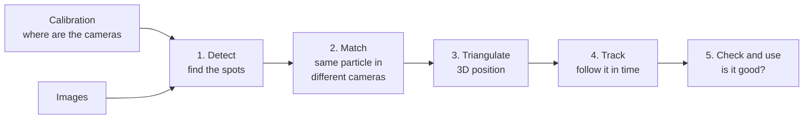

# Start here: the basics of 3D particle tracking

**Time:** 10 minutes to read. There is nothing to run on this page.

## What 3D-PTV measures

You put small particles in a fluid. Several cameras film the same place from different sides. Each camera sees every
particle as a small bright spot.

From the spots in all cameras, the software computes where each particle is in 3D. It follows the particle from frame to frame
and gets its speed. Many such tracks together measure the flow: velocity, acceleration, and statistics such as turbulence.

## The five steps

| Step | What it does | Page |
|---|---|---|
| Calibration | One file per camera. It says where the camera is, where it looks, and how the lens and the window bend the light. | [3. Cameras and calibration](03-cameras.md) |
| 1. Detect | Finds the bright spots in each image and their centres, to a fraction of a pixel. | [4. Find the particles](04-detect.md) |
| 2. Match | A spot in camera 1 lies on a line in camera 2 (the *epipolar line*). Spots that fit the lines in all cameras are one particle. | [5. Match across cameras](05-match.md) |
| 3. Triangulate | The lines of sight of the cameras cross at the particle. The crossing is its 3D position. | [5. Match across cameras](05-match.md) |
| 4. Track | Predict where the particle goes next and link it to the nearest candidate. Repeat for every frame. | [6. Track in time](06-track.md) |
| 5. Check and use | Count the particles, look at the track lengths, check that the tracks are smooth, check that the cameras agree, and compute velocities. | [7. Is the result good?](07-check.md), [8. Is the calibration good?](08-calibration.md), [9. Use the results](09-results.md) |

## How this course works

* **Every page has the same parts:** what the step does, what you need, the command, what you should see, how to check, what to
  do when it fails, and the next page.
* **Everything runs on data that comes with the program.** It is `test_data/test_cavity_small`: 4 cameras, 5 frames, 3 MB. You
  can type every command and compare your output with the page. The example is small on purpose, so each step takes seconds.
* **Command line and graphical interface** are shown side by side. The command line is also what the automatic tests run, so
  the pages stay correct when the code changes.
* **Your own data:** the [recipes](../recipes/index.md) start from what you have (for example "two rigs of four cameras and a
  hand-held plate") and send you back to these pages for each step.

## Words you will meet

See the [glossary](glossary.md). Five to know now:

* **frame**: one moment in time, with one image per camera
* **target**: a bright spot found in one image
* **correspondence**: targets in different cameras that are the same particle
* **trajectory**: the 3D path of one particle
* **calibration**: the camera files

[Next: 1. Install and check →](01-install.md){ .md-button .md-button--primary }
