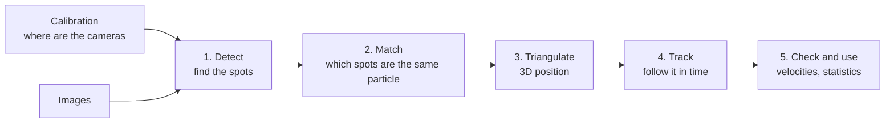

# Start here: the basics of 3D particle tracking

**Time:** 10 minutes to read, nothing to run on this page.

## What 3D-PTV measures

You seed a fluid with small particles and film it with several cameras that look at the same place from different sides.
Each camera sees every particle as a small bright spot. From the spots in all cameras, the software works out where each
particle is in 3D, and by following it from frame to frame, how fast it moves. A cloud of such tracks is a measurement of the
flow: velocity, acceleration, and from them statistics such as turbulence.

## The five steps

| Step | In one sentence | Course page |
|---|---|---|
| Calibration | A file per camera that says where it stands, where it looks and how the lens and the window bend the light. Without it, a spot in an image is only a direction-less dot. | [Cameras and calibration](03-cameras.md) |
| 1. Detect | Find the bright spots in each image and their centres, to a fraction of a pixel. | *coming next* |
| 2. Match | A spot in camera 1 lies on a line in camera 2 (the *epipolar line*). Spots on matching lines in all cameras are the same particle. | *coming next* |
| 3. Triangulate | The lines of sight from each camera cross at the particle; the crossing is its 3D position. | *coming next* |
| 4. Track | Predict where a particle goes next, link it to the nearest candidate, repeat. | *coming next* |
| 5. Check and use | Is the result good? How many particles, how long are the tracks, how smooth? | *coming next* |

## How this course works

* **Every page has the same shape:** what the step does, what you need, the exact command, what you should see, how to check
  it worked, what to do if not, and where to go next.
* **Everything runs on data that comes with the program** (`test_data/test_cavity_small`: 4 cameras, 5 frames, 3 MB). You can
  type every command and compare your output with the page. The example is deliberately small, so it finishes in seconds; a real
  experiment has thousands of frames, and the numbers scale, not the method.
* **Command line and graphical interface** are shown side by side. The command line is also what the automatic tests run, so
  the pages cannot silently go out of date.
* **When you are ready for your own data**, the [recipes](../recipes/index.md) start from what you have (for example, "two rigs
  of four cameras and a hand-held plate") and send you back to these pages for each step.

## Words you will meet

See the [glossary](glossary.md). The ones to know first: **frame** (one moment in time, one image per camera), **target**
(a detected spot), **correspondence** (spots in different cameras that are the same particle), **trajectory** (the 3D path of
one particle), **calibration** (the camera files).

[Next: install and check →](01-install.md){ .md-button .md-button--primary }
