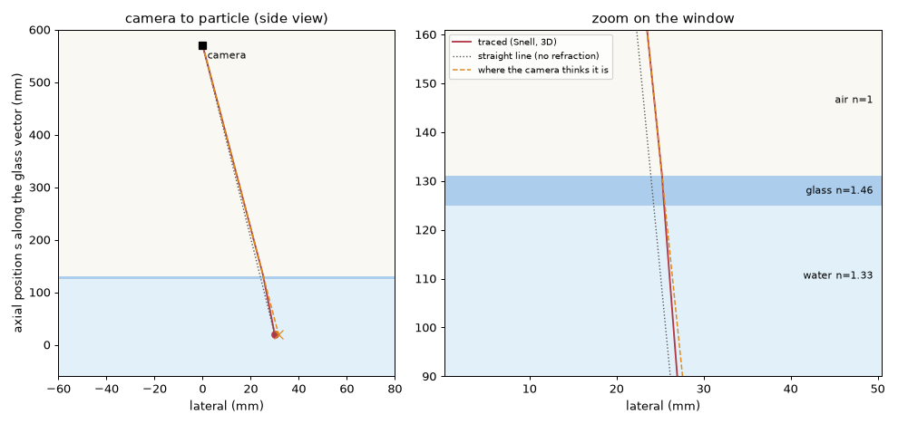
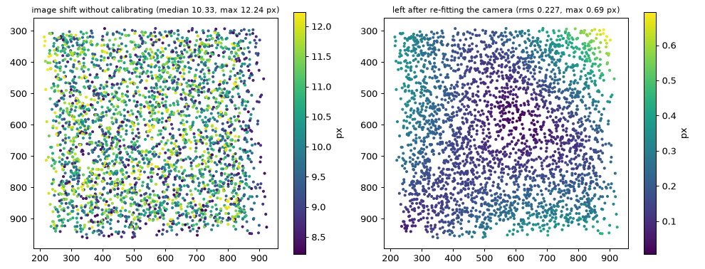

# Ray tracing through the window against the radial-shift model

An interactive marimo notebook walks through the independent ray tracer of `docs/synthetic-rig.md` and compares it with the
multimedia model that openptv2 uses (the radial shift of `openptv2.algorithms.multimed`):

```bash
uv run marimo edit docs/notebooks/ray_tracing_multimedia.py     # sliders: particle, glass thickness, index, tilts
```

It needs no data files: the rig is `cavity_rig()` (two cameras per side of a water cell, glass 6 mm, n = 1 / 1.46 / 1.33).



*Red: the traced path (Snell's law in 3D). Dotted: the straight line to the particle. Dashed orange: where the camera thinks the
particle is (the air ray continued to the same distance). Right: zoom on the window.*

## The two models in two sentences

* **Radial shift (library).** Assumes flat layers perpendicular to the glass vector, so the whole path lies in one plane through
  the glass axis and `n sin(theta)` is the same in every layer. One scalar per point (the shift `r_q / r`), found by iteration and
  stored in a look-up table. Fast, and exact for that geometry.
* **Tracer (`TruthRig`).** Finds the 3D direction in the air such that the ray, refracted by the vector Snell law at each of two
  planes (each a point and a normal), ends at the particle: Gauss-Newton on two angles, no assumption on the orientation of the planes.
  About 100 times slower per point (58 ms against 0.6 ms for 3000 points, one camera), so it is a truth and a test tool.

For flat parallel windows they agree to 0.0007 px at most: each checks the other.

## What a wrong assumption does, and what a calibration absorbs

One camera, 3000 points in the +-30 mm cube; "after" = camera position, angles, `cc` and principal point re-fitted to the tracer's
pixels with the library's model. Numbers are the rms of the *per-coordinate* pixel difference (`notebooks/...` prints the rms of
the pixel *distance*, 1.41 times larger):

| the truth deviates by | image shift before | left after the re-fit | left / shift |
|---|---|---|---|
| fluid index +0.04 | 3.3 px | 0.049 px (max 0.17) | 1.5 % |
| glass 4 mm thicker | 1.5 | 0.006 (max 0.02) | 0.4 % |
| water-side window tilted 1.2 deg | 2.0 | 0.040 (max 0.14) | 2.0 % |
| air-side window tilted 1.2 deg (wedge) | 7.4 | 0.158 (max 0.63) | 2.1 % |
| wedge 0.3 deg | 1.8 | 0.037 (max 0.14) | 2.1 % |



*Wedge of 1.2 deg: left, image shift of each volume point (pixel distance); right, what is left after the re-fit. The left-over is
a smooth pattern, largest at one sensor corner.*

Index and thickness errors are absorbed almost completely, but the camera has been moved to hide them (they are not recovered:
see `docs/self-calibration-cavity-synthetic.md`, section 3). Tilts are the least well absorbed.

## What it suggests (measured and not)

Measured: the library model is right for flat parallel windows and faster; for a tilted or wedge window it cannot be right, and
0.04-0.16 px (per coordinate) remains after calibration, below the noise of one detection but systematic.

Ideas, **not tested**:

1. **Exact backward rays** (pixel to the ray in water, two vector refractions, no iteration and no table) valid for any window
   orientation.
2. **Tilt as calibration parameters** (2 per camera). The open question is whether the data can tell a tilt from the camera angles;
   the synthetic cavity (truth known) is the place to test it: recover a planted 0.3 deg tilt, and keep a 0 deg truth at 0.
3. **Measure the look-up table's error** against the tracer over the whole volume, especially for opposite-camera rigs.
4. **Render benchmarks with the tracer**, so that a flaw of the library's model can show up (a benchmark made with the model
   cannot reveal it). `TruthRig` already does this.

The tracer needs the same inputs (indices, thickness, glass vector): it is the same physics without the flat-parallel shortcut, not
better physics. For the common rig the shortcut is exact.
