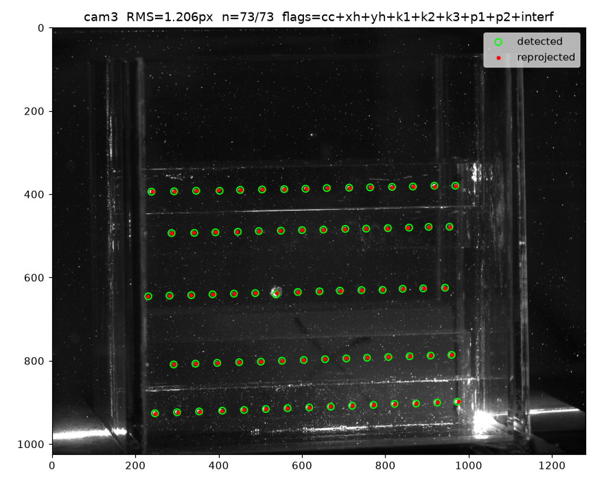
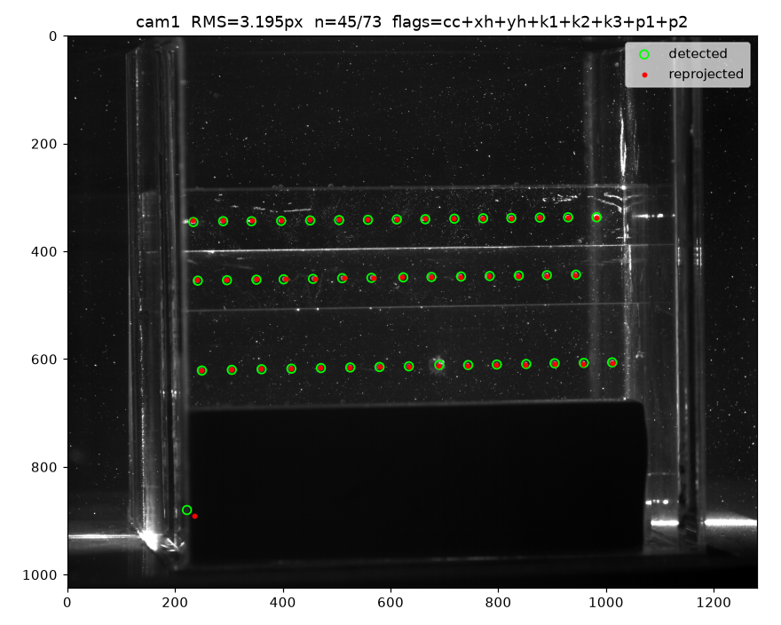

# One rig, a target with known 3D points (classic calibration)

**You have:** cameras fixed in place, and one image per camera of a target whose dots have known 3D positions (a plate that was
placed in the volume, or moved by known steps and listed in one file).
**You want:** the camera files (`.ori` and `.addpar`) for each camera.
**Time:** 20 minutes. **Tested:** the check and the dry run below run in CI on `test_data/test_cavity`. Writing the files is not
tested, because it changes the folder.

If your plate is held **by hand at unknown positions**, use [two rigs, hand-held plate](plate-calibration-two-rigs.md) instead.
Course page [3](../course/03-cameras.md) explains what the camera files contain.

## 1. What you need

* One image per camera: `cal/cam1.tif` ... `cal/camN.tif`.
* The 3D target file `cal/target_on_a_side.txt`: one line per dot, `id x y z` (mm).
* For each camera, a first guess `cal/camN.tif.ori` and `cal/camN.tif.addpar`, and the dots found in the image:
  `cal/camN.tif_targets`. The first guess may be rough, but it must be close enough to match dots to the target.
* The parameter file, with the right image size, pixel size and the three indices (air 1.0, glass, water; a common mistake is to swap the last two).

## 2. Check what is there

```bash
cp -r test_data/test_cavity cal_run
```

```bash
python skills/openptv-calibrate/scripts/calib.py inspect cal_run --output inspect.json
```

```text
Success! Inspection written to: inspect.json
ready_headless=True  problems=0
```

`ready_headless=True` means the folder has everything the command line needs. If `problems` is not 0, the file
`inspect.json` lists what is missing. Fix that first.

## 3. Try the calibration without writing anything

```bash
python skills/openptv-calibrate/scripts/calib.py run cal_run --output calib.json --dry-run
```

```text
Success! Calibration report written to: calib.json
  cam1: matched 45/73  RMS=3.195px  flags=cc+xh+yh+k1+k2+k3+p1+p2
  cam2: matched 45/73  RMS=3.2763px  flags=cc+xh+yh+k1+k2+k3+p1+p2+interf
  cam3: matched 73/73  RMS=1.2055px  flags=cc+xh+yh+k1+k2+k3+p1+p2+interf
  cam4: matched 72/73  RMS=1.0628px  flags=cc+xh+yh+k1+k2+k3+p1+p2+interf
cross-camera RCM (42 pts in all 4 cams, 73 in >=2): p50=0.057mm p95=0.287mm max=0.665mm
WARNING: cross-camera RCM high relative to per-camera RMS; consider a tracer self-calibration / dumbbell pass (see roadmap).
  mean RMS (4/4 cameras): 2.185px  (dry-run)
```

Without `--dry-run` the same command writes the camera files and keeps the old ones as `*.autobck`.

## 4. What you should see

Per camera: **matched** (how many of the 73 target dots were found and used) and **RMS** (the miss in pixels when the model
projects the dots back into the image). The command also draws an overlay for each camera in `cal_run/cal/auto_calib/`:
green circles are the dots found in the image, red points are where the model puts them. **The red points should sit inside the green circles.**



*Camera 3, RMS 1.2 px. All dots matched.*



*Camera 1, RMS 3.2 px, 45 of 73 dots. This camera is the weak one here.*

## 5. How good is good enough

| Number | Good | Look again |
|---|---|---|
| RMS per camera | below 2 px (the tool's own rule); the lower the better | above 2 px |
| matched | nearly all dots (here 73 of 73) | much fewer, as in cameras 1 and 2 here (45 of 73) |
| cross-camera RCM | small compared with the size of one pixel in the volume (here 1 px is about 0.095 mm) | the tool prints a WARNING when it is high relative to the RMS (here p95 = 0.29 mm) |

The RCM is the distance between the rays of different cameras that should meet at one dot. It sees what the RMS of one camera
cannot: cameras that each fit their own image, but disagree with each other. If the WARNING appears, calibrate again, or refine
with the particles ([page 8](../course/08-calibration.md), [dumbbell](dumbbell.md)). This bundled calibration is good enough for
the course. It is an honest example, and not a model of a perfect one.

## 6. If the first guess is missing: the four-point seed

Without a first guess, the program needs four well-separated target dots per camera, with their ids and pixel positions. Clicking
them is the only step that needs a screen:

```bash
python skills/openptv-calibrate/scripts/calib.py pick my_rig
```

A window opens for each camera. Click the highlighted points in the order shown. `render` makes reference images to help, and `seed
--seed-json` takes the four points from a file when no screen is available. Then run section 3 again. In the graphical interface the
same step is *Calibration → Create calibration*.

## 7. Refine with the particles (optional)

When you have tracked a run, the particles themselves can refine the calibration:

```bash
python skills/openptv-calibrate/scripts/calib.py snapshot-refine my_rig --dry-run
```

Track again afterwards. The new cameras must be checked like any other ([page 8](../course/08-calibration.md)).

## If it did not work

| You see | Cause | What to do |
|---|---|---|
| `problems` is not 0 | a file is missing | read `inspect.json` |
| few dots matched | first guess too far off | make a new first guess (section 6) |
| RMS high for all cameras | indices swapped, or wrong pixel size | check `mmp_n2` and `mmp_n3` and `pix_x` in the YAML |
| red points sit off the circles in one pattern | the model is missing a term, or a wrong index | the `flags` show which terms were fitted; check the indices |

## Next

[Dumbbell: check or fix the scale](dumbbell.md), [Is the calibration good?](../course/08-calibration.md), [Calibration tutorial (all options)](../tutorials/calibration.md).
