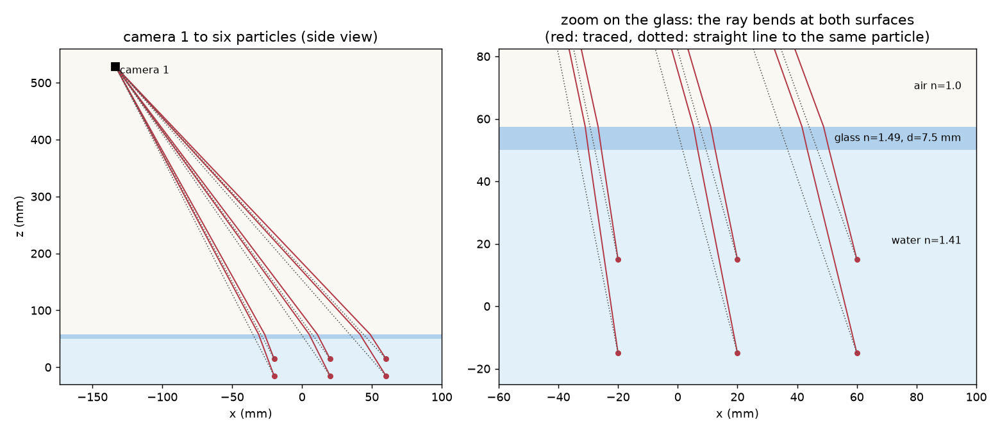
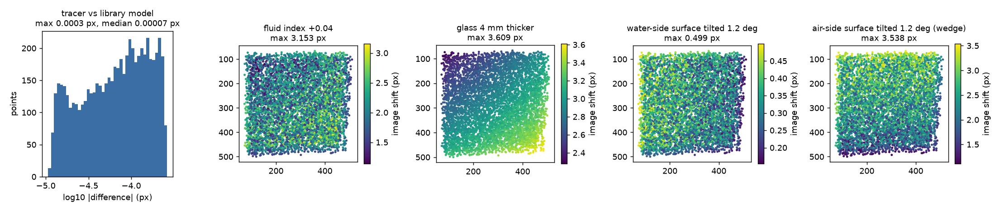

# The truth rig: an independent ray tracer for testing calibration

`openptv2.synthetic_rig.TruthRig` computes where a 3D point appears in each camera by tracing the light ray through the
real physical layers, with Snell's law in 3D. It is deliberately **not** the code the library uses to calibrate and track.
That gives a test bed with a known answer: the rig is the truth, a calibration is a guess about it, and every difference is
known.



*Left: camera 1 and six particles in the water (syn1 geometry, glass 7.5 mm, n = 1.0 / 1.49 / 1.41). Right: zoom on the glass.
The red ray is the traced path; the dotted line is the straight line to the same particle, which is what you would get without
refraction. The kinks at the two surfaces are Snell's law.*

## What it computes

1. **Layers.** Per camera, the glass vector `g` of the calibration (`|g|` = distance of the water-side surface from the origin,
   direction = the surface normal) defines two planes: the water-side surface at `|g|` and the air-side surface at
   `|g| + d`. Optionally each plane's normal is rotated by a small tilt (a tilted window, or a wedge when the two differ).
2. **The ray that really arrives.** For a particle `P`, find the unit direction `u` leaving the camera centre `C` such that
   after refraction at the air-glass plane (`n_air → n_glass`) and the glass-water plane (`n_glass → n_water`) the ray passes
   through `P`. This is a 2-unknown root problem per point, solved by vectorised Gauss-Newton on the perpendicular miss
   distance (`air_direction`). Vector Snell law: `v = η u + (η cosθi − cosθt) n`, `η = n_a / n_b`, total reflection gives NaN.
3. **Image.** The ray, continued straight in air, defines an effective point `C + u·|P − C|`. That point is projected with the
   camera's own pinhole and lens distortion (principal point, `cc`, `k1 k2 k3`, `p1 p2`, affine terms) **without** multimedia,
   then converted to pixels. Points outside the sensor are NaN. `observe()` adds Gaussian centroid noise.

```python
from openptv2.synthetic_rig import TruthRig
rig = TruthRig.from_cals(cals, cpar)                     # the cameras and layers of an existing calibration
px = rig.project(points)                                 # (N, n_cams, 2) pixels
rig2 = rig.with_(n_water=1.45, tilt_back=[(0, 0.02)]*4)  # a different truth: fluid index and a wedge
rig.ray_path(0, points)                                  # (N, 4, 3): camera, air-glass point, glass-water point, particle
rig.model_cpar()                                         # the multimedia a perfect calibration would use
```

The library's own model (`project_pixels`) does it differently: it assumes flat parallel layers and finds a radial shift
factor iteratively. For flat parallel layers the two must agree. They do:



*Left: over 6000 points in the syn1 volume the tracer and the library model differ by at most 0.0003 px (median 0.00007 px):
both are correct for the ideal case. Right four panels: the image shift of camera 1 when the truth deviates from the model in one
way (colour = shift in px, plotted over the image).*

| truth deviates from the nominal model by | image shift, median / max |
|---|---|
| fluid index + 0.04 | 2.07 / 3.15 px |
| glass 4 mm thicker | 2.98 / 3.61 px |
| water-side surface tilted 1.2° | 0.33 / 0.50 px |
| air-side surface tilted 1.2° (wedge) | 2.37 / 3.54 px |

These are large in the image, yet a calibration that is fitted afterwards (exterior, principal point, distortion) absorbs almost
all of them: see `docs/plans/2026-11-26-calibration-lab.md` (3-36 µm left in the volume). The shift is smooth and nearly uniform
across the sensor, which is exactly what camera position, `cc` and the principal point can imitate.

## Tests and limits

`tests/unit/test_synthetic_rig.py` checks the agreement with the library to 2e-3 px, that each deviation moves the image by a
measurable but sane amount, and that `with_` copies. Reproduce the figures with
`uv run python bench/calibration_lab/rig_figures.py`.

Not modelled: curved or non-planar windows, layers that vary in thickness across the aperture beyond a plane tilt, light that
leaves the sensor plane model (rolling shutter, vibration), dispersion, lens aberrations beyond the polynomial terms, blob shape
(the detector is tested separately in `bench/calibration_lab/detection_bias.py`). Rays are traced from one point per camera;
there is no aperture or defocus.
